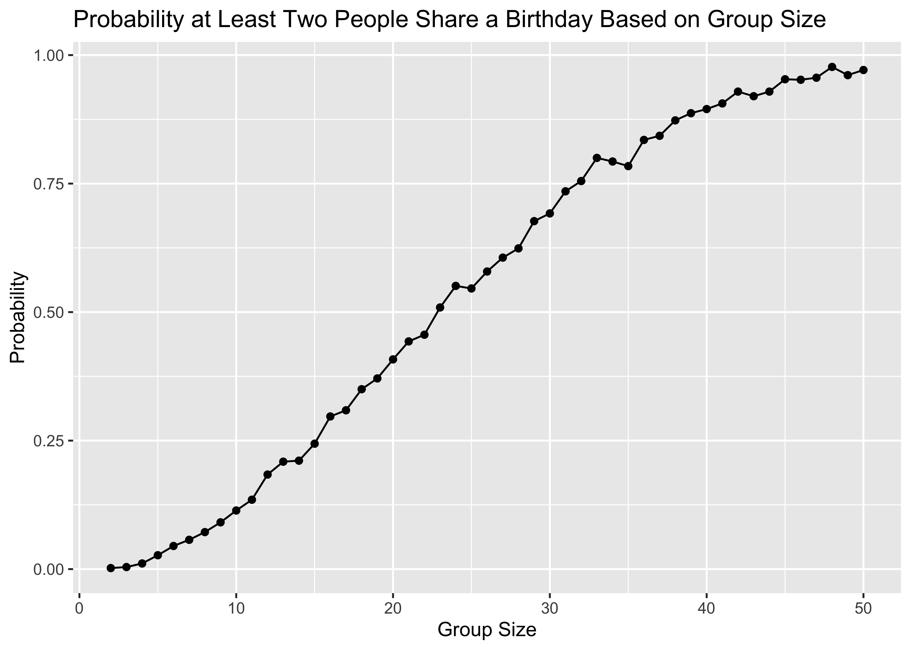
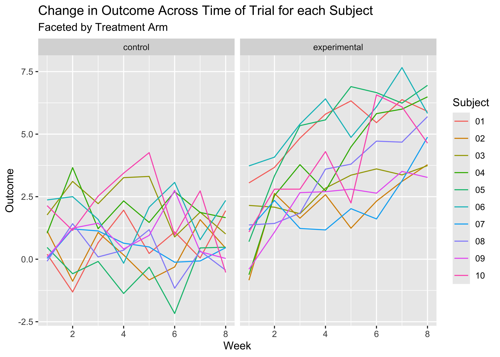
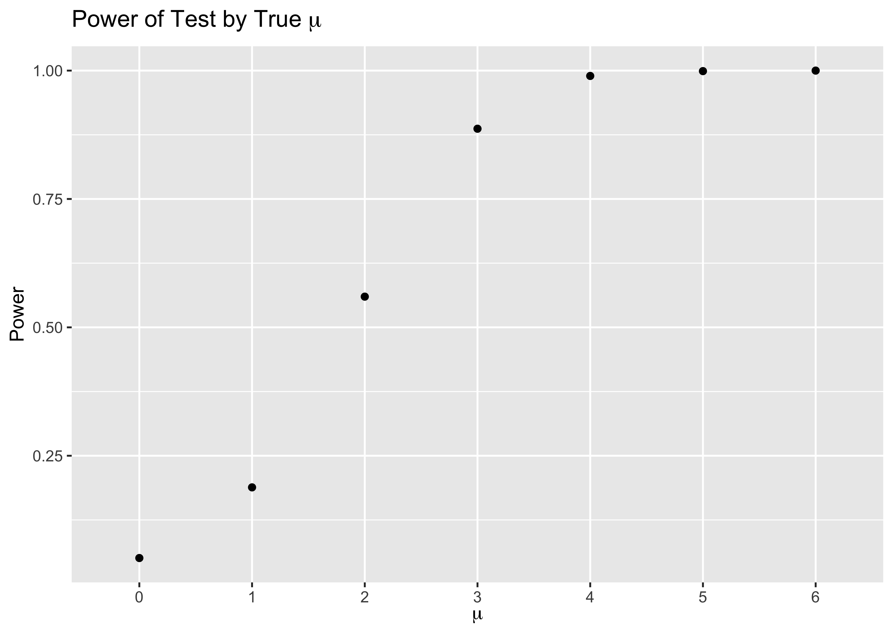
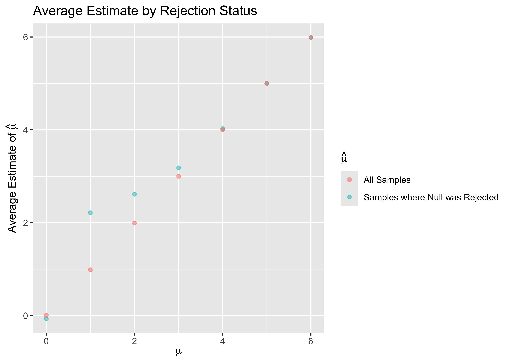

HW05
================
Jonathan Morris
2026-11-14

``` r
knitr::opts_chunk$set(
  dpi = 300,
  fig.retina = 2
)
```

``` r
library(tidyverse)
library(latex2exp)
```

## Problem 1

### Suppose you put n people in a room, and want to know the probability that at least two people share a birthday. For simplicity, we’ll assume there are no leap years (i.e. there are only 365 days) and that birthdays are uniformly distributed over the year (which is actually not the case).

### Write a function that, for a fixed group size, randomly draws “birthdays” for each person; checks whether there are duplicate birthdays in the group; and returns TRUE or FALSE based on the result.

``` r
## Initialize function:
birthday_repeated = function(n_room){
  birthdays = sample(1:365, size = n_room, replace = TRUE)
  
  repeated_birthdays = length(unique(birthdays)) < n_room
  
  return(repeated_birthdays)
}
```

### Next, run this function 10000 times for each group size between 2 and 50. For each group size, compute the probability that at least two people in the group will share a birthday by averaging across the 10000 simulation runs. Make a plot showing the probability as a function of group size, and comment on your results.

``` r
## Create the simulated birthday df:
birthday_large_df = 
  expand_grid(
   number_of_people = c(2:50),
   iter = 1:1000
 ) |> 
  mutate(
    repeated = map_lgl(number_of_people, birthday_repeated)
  ) |> 
  group_by(number_of_people) |> 
  summarize(p = mean(repeated))
```

``` r
## Create plot:
birthday_large_df |> 
  ggplot(aes(x = number_of_people, y = p)) +
  geom_point() +
  geom_line() +
  labs(x = "Group Size", y = "Probability", title = "Probability at Least Two People Share a Birthday Based on Group Size")
```



The plot shows that as group size increases, the probability of at least
two people sharing the same birthday also increases near-linearly. As
the number of people crosses to 23, we have a 50% probability of two
people sharing a birthday, and the probability gets very close to 1 as
we reach 50 people.

## Problem 2

### This zip file contains data from a longitudinal study that included a control arm and an experimental arm. Data for each participant is included in a separate file, and file names include the subject ID and arm.

### Create a tidy dataframe containing data from all participants, including the subject ID, arm, and observations over time:\`\`

``` r
### Start with a dataframe containing all file names; the list.files function will help
#files_df = tibble(
#  file = paste0("data/", list.files("data")))
files_df = tibble(file = list.files("data"))
  

### Iterate over file names and read in data for each subject using purrr::map and saving the result as a new variable in the dataframe
study_df = files_df |> 
  mutate(
    repeated = map(paste0("data/", file), read_csv)
  )

### Tidy the result; manipulate file names to include control arm and subject ID, make sure weekly observations are “tidy”, and do any other tidying that’s necessary
study_df = study_df |> 
  unnest(cols = c(repeated)) |> 
  pivot_longer(cols = contains("week"),
               names_to = "week",
               values_to = "value",
               names_prefix = "week_") |> 
  mutate(arm = case_when(
    str_detect(file, "con") ~ "control",
    str_detect(file, "exp") ~ "experimental"
  ),
  subject_id = str_extract(file, "\\d+"),
  week = as.numeric(week), 
  arm = factor(arm))

head(study_df)
```

    ## # A tibble: 6 × 5
    ##   file        week value arm     subject_id
    ##   <chr>      <dbl> <dbl> <fct>   <chr>     
    ## 1 con_01.csv     1  0.2  control 01        
    ## 2 con_01.csv     2 -1.31 control 01        
    ## 3 con_01.csv     3  0.66 control 01        
    ## 4 con_01.csv     4  1.96 control 01        
    ## 5 con_01.csv     5  0.23 control 01        
    ## 6 con_01.csv     6  1.09 control 01

### Make a spaghetti plot showing observations on each subject over time, and comment on differences between groups.

``` r
study_df |> 
  ggplot(aes(x = week, y = value, color = subject_id)) +
  geom_line() +
  labs(x  = "Week", y = "Outcome", color = "Subject", title = "Change in Outcome Across Time of Trial for each Subject", subtitle = "Faceted by Treatment Arm") +
  facet_wrap(. ~ arm)
```



For the control arm, we don’t see much of a trend in the outcome across
time. In contrast, the experimental arm seems to have an increase in the
outcome as the weeks progress! Overall, the variance between groups
seems to be similar.

## Problem 3

### When designing an experiment or analysis, a common question is whether it is likely that a true effect will be detected – put differently, whether a false null hypothesis will be rejected. The probability that a false null hypothesis is rejected is referred to as power, and it depends on several factors, including: the sample size; the effect size; and the error variance. In this problem, you will conduct a simulation to explore power in a one-sample t-test.

First set the following design elements:

Fix n=30 Fix $\sigma$=5 Set $\mu$=0.

Generate 5000 datasets from the model: $x \sim N(\mu, \sigma)$.

For each dataset, save $\hat{\mu}$ and the p-value from a test of
$H_0: \mu = 0$, with $\alpha = 0.05$.

Repeat the above for $\mu =\{1,2,3,4,5,6\}$, and complete the following:

``` r
## Create function:
sim_normal = function(mu){
  samp = rnorm(n = 30, mean = mu, sd = 5)
  return(samp)
}

## Generate data and run t-tests:
sim_data = expand_grid(
  mu = 0:6,
  iter = 1:5000
) |> 
  mutate(
    repeated = map(mu, sim_normal),
    mu_hat   = map(repeated, mean),
    t_res    = map(repeated, \(x) t.test(x, mu = 0)),
    p_value  = map_dbl(t_res, \(t) t$p.value)
  ) |> 
  select(-repeated, -t_res) |> 
  unnest(cols = c(mu_hat))
```

### Make a plot showing the proportion of times the null was rejected (the power of the test) on the y axis and the true value of $\mu$ on the x axis. Describe the association between effect size and power.

``` r
sim_data |> 
  mutate(reject = p_value < 0.05) |> 
  group_by(mu) |> 
  summarize(power = mean(reject)) |> 
  ggplot(aes(x = factor(mu), y = power)) +
  geom_point() +
  labs(x = TeX(r"($\mu$)"), 
       y = "Power", 
       title = TeX(r"(Power of Test by True $\mu$)"))
```



There seems to be a clear positive association between the true value of
$\mu$ and the power of the test. This suggests that as the effect size
gets larger, we observe much higher power. The result is intuitive; as
our sampled mean progresses farther away from the null $\mu$ value of 0,
we will have a stronger effect size and greater difference between
$\hat{\mu}$ and the null value, thus higher power.

### Make a plot showing the average estimate of $\hat{\mu}$ on the y axis and the true value of $\mu$ on the x axis. Make a second plot (or overlay on the first) the average estimate of $\hat{\mu}$ only in samples for which the null was rejected on the y axis and the true value of $\mu$ on the x axis.

``` r
## Make a data frame with the average estimate of mu_hat for all  data:
mu_avg = sim_data |> 
  group_by(mu) |> 
  summarize(mu_hat_avg = mean(mu_hat))

## Calculate average mu_hat only within samples rejected:
sim_data |> 
  mutate(reject = p_value < 0.05) |> 
  group_by(mu, reject) |> 
  summarize(mu_hat_sig = mean(mu_hat)) |> 
  filter(reject == TRUE) |> 
  left_join(mu_avg, by = "mu") |> 
  pivot_longer(cols = contains("mu_hat"),
               values_to = "mu_val",
               names_to = "mu_hat") |> 
  mutate(mu_hat = case_when(
    mu_hat == "mu_hat_sig" ~ "Samples where Null was Rejected",
    mu_hat == "mu_hat_avg" ~ "All Samples"
  )) |> 
  ggplot(aes(x = mu, y = mu_val, color = mu_hat)) +
  geom_point(alpha = 0.5) +
  labs(x = TeX(r"($\mu$)"), 
       y = TeX(r"(Average Estimate of $\hat{\mu}$)"), 
       color = TeX(r"($\hat{\mu}$)"), 
       title = "Average Estimate by Rejection Status")
```

    ## `summarise()` has regrouped the output.
    ## ℹ Summaries were computed grouped by mu and reject.
    ## ℹ Output is grouped by mu.
    ## ℹ Use `summarise(.groups = "drop_last")` to silence this message.
    ## ℹ Use `summarise(.by = c(mu, reject))` for per-operation grouping
    ##   (`?dplyr::dplyr_by`) instead.



## Is the sample average of $\hat{\mu}$ across tests for which the null is rejected approximately equal to the true value of $\mu$? Why or why not?

No, the sample average is not approximately equal to the true value of
$\mu$ for all values of $\mu$. For true $\mu$ values that are low (1,
2), the test has low power to detect an effect, causing the t-test to
use a more conservative significance cutoff. Because the true means in
these cases are still close to zero and low, the test only flags
significant samples when they are very far off from the null value. In
the case of $\mu$ = 0, the estimates from the significant samples are
symmetric around zero, so they cancel out and leave the estimate right
around 0. You can see that when our power reaches above 80%, as with
$\mu = 3, 4, 5, 6$, the average of $\hat{\mu}$ does approximate the true
value of $\mu$, because power is much higher.
