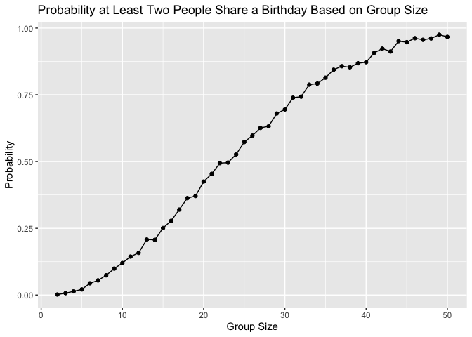

HW05
================
Jonathan Morris
2026-11-14

``` r
library(tidyverse)
```

    ## ── Attaching core tidyverse packages ──────────────────────── tidyverse 2.0.0 ──
    ## ✔ dplyr     1.2.1     ✔ readr     2.2.0
    ## ✔ forcats   1.0.1     ✔ stringr   1.6.0
    ## ✔ ggplot2   4.0.3     ✔ tibble    3.3.1
    ## ✔ lubridate 1.9.5     ✔ tidyr     1.3.2
    ## ✔ purrr     1.2.2     
    ## ── Conflicts ────────────────────────────────────────── tidyverse_conflicts() ──
    ## ✖ dplyr::filter() masks stats::filter()
    ## ✖ dplyr::lag()    masks stats::lag()
    ## ℹ Use the conflicted package (<http://conflicted.r-lib.org/>) to force all conflicts to become errors

## Problem 1

### Suppose you put n people in a room, and want to know the probability that at least two people share a birthday. For simplicity, we’ll assume there are no leap years (i.e. there are only 365 days) and that birthdays are uniformly distributed over the year (which is actually not the case).

### Write a function that, for a fixed group size, randomly draws “birthdays” for each person; checks whether there are duplicate birthdays in the group; and returns TRUE or FALSE based on the result.

``` r
## Initialize function:
birthday_repeated = function(n_room){
  birthdays = sample(1:365, size = n_room, replace = TRUE)
  
  repeated_birthdays = length(unique(birthdays)) < n_room
  
  return(repeated_birthdays)
}
```

### Next, run this function 10000 times for each group size between 2 and 50. For each group size, compute the probability that at least two people in the group will share a birthday by averaging across the 10000 simulation runs. Make a plot showing the probability as a function of group size, and comment on your results.

``` r
## Create the simulated birthday df:
birthday_large_df = 
  expand_grid(
   number_of_people = c(2:50),
   iter = 1:1000
 ) |> 
  mutate(
    repeated = map_lgl(number_of_people, birthday_repeated)
  ) |> 
  group_by(number_of_people) |> 
  summarize(p = mean(repeated))
```

``` r
## Create plot:
birthday_large_df |> 
  ggplot(aes(x = number_of_people, y = p)) +
  geom_point() +
  geom_line() +
  labs(x = "Group Size", y = "Probability", title = "Probability at Least Two People Share a Birthday Based on Group Size")
```

<!-- -->
